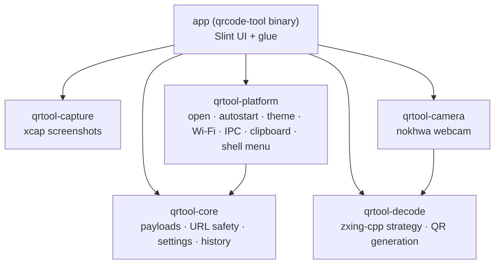
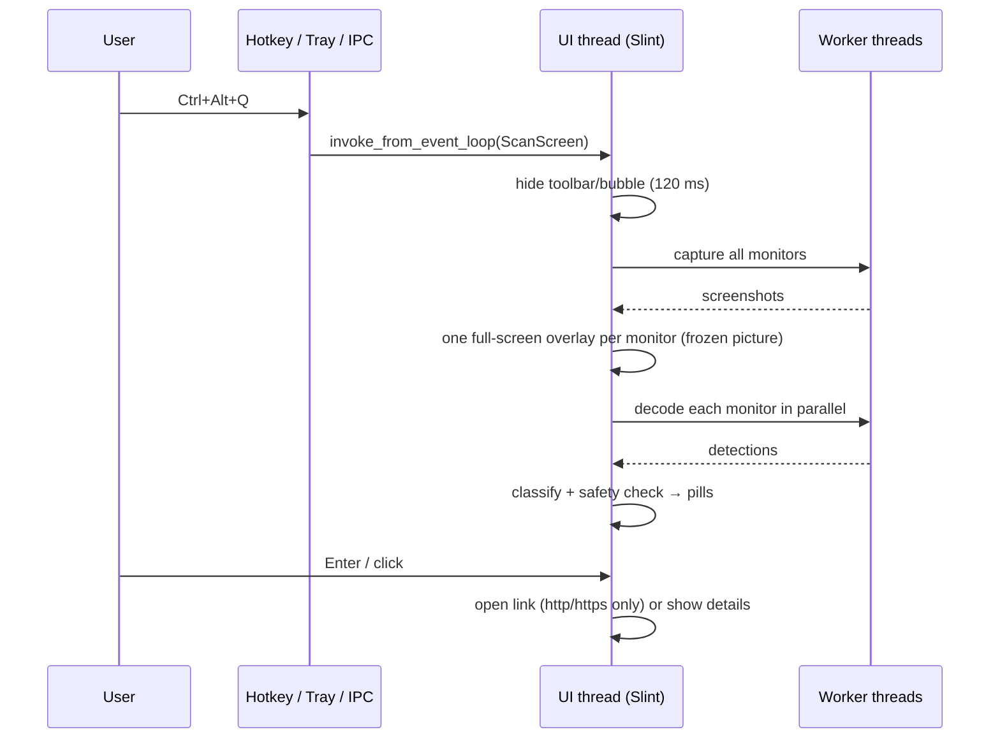

# Architecture

This document explains how QRcode tool is put together and why. For day-to-day rules see
[AGENTS.md](../AGENTS.md).

## Goals that shaped the design

1. **Phone-like speed**: shortcut → codes labelled in well under a second, Enter opens.
2. **Safe by default**: nothing opens by surprise; deceptive links are explained.
3. **Light**: a tray app that idles with no windows, a small installer, no runtime.
4. **Native feel** on Windows 11 first, same code base for macOS and Linux.

## Crates

- **qrtool-core** has no UI and almost no I/O, so the important logic (what a payload is,
  whether a link is suspicious, what may be opened automatically) is fully unit-tested.
- **qrtool-decode** wraps zxing-cpp. It owns the *strategy*: full pass, 2× upscale for small
  images, overlapping tiles for large ones, padded and upscaled region crops, de-duplication
  and reading-order sorting.
- **qrtool-capture**, **qrtool-camera** and **qrtool-platform** isolate OS-specific code.
- **app** contains the windows, the dispatcher and the glue. Business rules stay out of it.

## Process model

One process, one UI thread (the Slint/winit event loop), short-lived worker threads.

- State lives in a thread-local `Rc<App>`; workers never touch it. They send results back
  with `slint::invoke_from_event_loop`.
- Global shortcuts (`global-hotkey`, which uses `RegisterHotKey` on Windows) and the
  single-instance IPC server (local socket / named pipe) also post into the event loop.
- Windows are created on demand and dropped when closed, so the idle app holds only the tray.

## Screen scan details

- **Freeze first**: all monitors are captured before any overlay appears. The overlay shows the
  frozen picture, so the user selects on exactly what was decoded, animations do not interfere,
  and our own windows are not in the picture.
- **Coordinates**: detections stay in screenshot pixels. Each overlay receives `img-w`/`img-h`
  and scales pills and the selection rectangle itself. This avoids DPI conversion bugs on
  mixed-scale multi-monitor setups.
- **Overlay windows** are borderless, always on top, positioned on their monitor before they
  are shown (so they get the right scale factor) and then made borderless-fullscreen on that
  monitor. On Windows they are tool windows (no taskbar button, not in Alt+Tab).
- **Selection**: Tab cycles through codes across all monitors; Enter runs the primary action;
  `C` copies; `F` rescans; Esc or right-click closes.

## Payloads and safety

`qrtool_core::payload::classify` turns decoded text (and raw bytes, for Big5 e-invoices) into
a `Payload`: URL, other scheme, Wi-Fi, contact, email, phone, SMS, geo, OTP, crypto,
e-invoice (left/right) or text.

`qrtool_core::url_safety::analyze_url` produces a `UrlReport` with findings and a severity:

| Severity | Examples | Behaviour |
|---|---|---|
| Ok / Info | clean https; very long URL | Enter opens directly |
| Warning | http, IDN, IP address, port, short link | details card first, user must press Open |
| Danger | `user@host` disguise, mixed alphabets | details card, "Open anyway" second confirmation |

Automatic opening (`scan::auto_open_candidate`) requires: exactly one code, a clean report,
the site on the trusted list and the setting enabled. Only `http`/`https` ever reach
`open_web`, which re-checks the scheme.

## UI

- Slint with the Fluent style. Translations are bundled into the binary at build time
  (`app/translations/<lang>/LC_MESSAGES/qrcode-tool.po`) and switched at runtime.
- Each component has its own copy of the `Theme` global; Rust pushes dark mode, accent colour
  and high contrast into every window (`theme::apply_theme!`), polling the system every 3 s.
- The tray uses Slint's built-in `SystemTrayIcon` (no extra tray crate).

## Persistence

| File | Location (Windows) | Content |
|---|---|---|
| `settings.toml` | `%APPDATA%\Lrniey666\qrcode-tool\config\` | settings, written atomically |
| `history.jsonl` | `%LOCALAPPDATA%\Lrniey666\qrcode-tool\data\` | only if history is enabled; never sensitive payloads |
| `logs\qrcode-tool.*.log` | `%LOCALAPPDATA%\Lrniey666\qrcode-tool\data\logs\` | events/errors, 5 days |

(macOS: `~/Library/Application Support/io.github.Lrniey666.qrcode-tool/`,
Linux: `~/.config/qrcode-tool/` and `~/.local/share/qrcode-tool/`.)

## Updates and distribution

Velopack (`VelopackApp::build().run()` at the very start of `main`) handles install, update and
uninstall hooks. The update check asks GitHub Releases once at start-up (after a delay) and
then daily; downloading and restarting only happens after the user agrees. Portable and
developer builds detect that they are not installed and say so.

## Performance budget

| Metric | Target |
|---|---|
| Installer | < 15 MB |
| Idle memory | < 30 MB |
| Shortcut → overlay | < 200 ms |
| 4K screen decode | < 300 ms |

Release builds optimise for size (`opt-level = "s"`, fat LTO) except the decoder and image
crates, which are optimised for speed.
