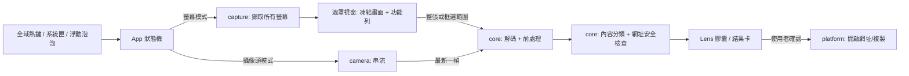

# 桌面 QR Code 掃描應用 — 規劃書 v0.1（草案）

> 建立日期：2026-10-05
> 狀態：草案，待確認
> 暫定名稱：**QRLoupe**（見第 11 章，尚未定案）
>
> **使用方式**：第 1–15 章是評估與建議，第 16 章是**待你回答的問題清單**。每題都附上我的建議預設值，你只要在「你的回答」後面填寫；留空就代表採用建議值。

---

## 0. 一頁摘要（TL;DR）

| 主題 | 建議 |
|---|---|
| 定位 | 「在電腦上掃 QR code，跟用手機一樣簡單」：按一個熱鍵，畫面上的 QR code 就自動被標出來，按 Enter 開啟 |
| 最重要的設計改動 | **先凍結畫面再框選**（freeze-frame）＋**按下熱鍵立刻全螢幕自動偵測**，用 Google 智慧鏡頭式的網址膠囊標出所有 QR code；框選留給太小、偵測不到的碼 |
| 語言 | Rust |
| UI 框架 | **Slint**：有 Fluent（Win11）風格、透明無邊框視窗、內建翻譯機制；桌面應用可用 Royalty-free 授權，須標示使用 Slint |
| 解碼 | **zxing-cpp**（Rust 綁定，C++ 核心，辨識率最好，能回傳碼的位置）；純 Rust 的 rxing 當備案 |
| Windows 7 | **建議不支援**，最低版本設為 Windows 10。Rust 官方從 1.78 起已不支援 Win7，相關套件也大多要求 Win8.1/10 以上（見 5.1） |
| 資料庫 | **不需要 PostgreSQL**。設定存 TOML 檔，掃描紀錄（若要做）用內嵌的 SQLite 或 JSONL 即可 |
| 安裝與更新 | GitHub Releases 下載 `Setup.exe`，用 **Velopack** 做安裝和自動更新（支援 Rust、MIT 授權） |
| 程式碼簽章 | 你是台灣個人開發者，**用不了 Azure Artifact Signing**（個人只開放美國、加拿大）。可選：Microsoft Store（個人註冊免費）、SignPath Foundation（開源免費）、OV 憑證（約 150–300 美元/年） |
| 開發順序 | Windows 螢幕掃描 → 系統匣/設定/安裝 → 攝像頭 → macOS → Linux X11 → Wayland |

---

## 1. 產品定位

### 1.1 定位語句

> 手機掃 QR code 只要「打開相機 → 對準 → 點網址」。**本應用要讓電腦也做到一樣簡單**：不管 QR code 在螢幕上（PDF、網頁、簡報、LINE、Discord），還是在手邊的紙本、別人的手機上，都能快速、安全地打開。

### 1.2 目標情境

1. 網頁、PDF、簡報、聊天軟體裡的 QR code（最常見）
2. 線上會議／直播畫面裡分享的 QR code
3. 紙本通知、海報、發票上的 QR code，用電腦攝像頭掃
4. 別人手機螢幕上的 QR code（例如加 LINE 好友、活動報到）

### 1.3 非目標（第一版不做）

- QR code 產生器（可列入未來功能，見 Q-F5）
- 雲端同步、帳號系統
- 條碼（一維碼）管理、庫存用途
- 行動版 App

### 1.4 競品對照

| 工具 | 螢幕框選 | 攝像頭 | 自動偵測整個畫面 | 網址安全檢查 | 跨平台 | 備註 |
|---|---|---|---|---|---|---|
| Win11 剪取工具 | ✅（要按「文字動作」） | ❌ | ❌ | ❌ | Win11 限定 | 多一步操作 |
| Windows 相機 App | ❌ | ✅ | — | ❌ | Win10/11 | 另一個 App |
| CodeTwo QR Desktop Reader | ✅ | ✅ | ❌ | ❌ | Windows | 2019 年後停更 |
| ShareX | ✅ | ❌ | ❌ | ❌ | Windows | 大型截圖套件 |
| dzoffice/qrpeek | ✅ | ❌ | ❌ | ❌ | Windows | 實測有 DPI 座標偏移，「雙擊全螢幕」失效 |
| koreafinder/SnapQR | 透過 Win+Shift+S | ❌ | ❌ | ? | Win10/11 | 名稱已被使用 |
| alpkonakci/webcam-qr-scanner | 只能全螢幕 | ✅ | ✅（全螢幕一次） | ✅（只開 http/https） | Windows | 很新，0 star |
| **本應用（目標）** | ✅ | ✅ | ✅ | ✅ | Win/mac/Linux | |

### 1.5 差異化重點

1. **一鍵自動偵測**＋Lens 式網址膠囊（大部分情況：熱鍵 → Enter，兩步完成）
2. **攝像頭和螢幕整合在同一個工具裡**
3. **內建網址安全檢查**（防 QR 釣魚，也就是 quishing）
4. **輕量常駐**（Rust 原生，目標閒置記憶體 < 30 MB）
5. 繁體中文優先，支援 10 種語言
6. 跨平台

> 參考：Keepnet 統計，2025 年約 12% 的釣魚攻擊含有 QR code，2025 年 8 月到 11 月 QR 釣魚郵件約成長 5 倍。這是「預設先顯示網址、不直接開啟」的主要理由。

---

## 2. 功能規格

### 2.1 模式 A：螢幕掃描（核心功能）

**建議流程（在你原本的流程上加入「凍結畫面」與「自動偵測」）：**

```
按熱鍵
  → ① 立刻擷取所有螢幕的畫面（凍結）
  → ② 顯示全螢幕遮罩：凍結畫面調暗 + 頂部置中的一行式圖示功能列（類似 Win11 剪取工具）
  → ③ 背景同時對整個凍結畫面做自動偵測
       ├─ 有找到 → 每個 QR code 外圍畫圓角框，上方疊一個網址膠囊（類似 Google 智慧鏡頭）
       │            ├─ 只有 1 個 → 直接按 Enter 開啟
       │            └─ 多個     → 點膠囊開啟，或用 Tab 切換再按 Enter
       └─ 沒找到／碼太小 → 使用者拖曳框選 → 對框內放大後重試解碼
  → ④ 顯示結果（預設）或直接開啟（設定可改，但仍受安全規則限制，見第 3 章）
  → Esc 隨時取消
```

**為什麼要先凍結畫面：**
- qrpeek 的問題是「框選座標」和「實際擷取」用不同的座標系統，在 DPI 縮放下就對不上。改成先擷取、在擷取到的圖上框選，**框選座標直接就是圖片的像素座標**，可以從根本避免 DPI 偏移。
- 影片、會議畫面裡的 QR code 可能只出現一下子，凍結後就不會消失。
- Win11 剪取工具也是這樣做的。

**遮罩頂部功能列（一行圖示，滑鼠停留時顯示名稱、快捷鍵與一句說明）建議按鈕：**

| 圖示 | 功能 | 說明 |
|---|---|---|
| ⬚ | 矩形框選 | 預設模式 |
| ⛶ | 全螢幕偵測 | 重新掃描整個畫面 |
| 📷 | 切換到攝像頭 | |
| 📋 | 掃描剪貼簿中的圖片 | |
| 🖼 | 開啟圖片檔 | |
| 🕘 | 最近結果 | 需開啟掃描紀錄 |
| ⚙ | 設定 | |
| ✕ | 關閉 | Esc |

### 2.2 模式 B：攝像頭掃描

```
按熱鍵 → 開啟攝像頭預覽視窗（含功能列）
  → 即時偵測：在預覽畫面中的 QR code 上方疊網址膠囊（Lens 風格）
  → 同一個內容連續 N 幀都讀到才算成功（防抖）
  → 顯示網址（預設）／直接開啟（設定）
  → 成功後：保持開啟繼續掃，或自動關閉（設定）
```

要處理的細節：
- 多鏡頭時要能選擇，並記住上次用的鏡頭
- 鏡像翻轉開關（前鏡頭常是鏡像）
- 掃手機螢幕時有摩爾紋、反光：可提示「降低手機亮度、稍微傾斜」
- 冷卻時間：開過一個網址後 N 秒內不重複開
- **視窗關閉或隱藏時立刻釋放攝像頭**，避免攝像頭指示燈一直亮
- 筆電沒有自動對焦時，太近會讀不到：可提示「距離 15–30 公分」

### 2.3 模式 C：功能列與浮動泡泡（Floating Bubble）

- 用熱鍵叫出獨立功能列（沒有遮罩），按鈕和 2.1 的功能列相同，再加「釘選」「縮成泡泡」
- 功能列可以拖動；拖到螢幕邊緣會吸附
- 縮成泡泡後是一個小圓形圖示：**點一下＝開始螢幕掃描**，右鍵開選單，拖曳可移動
- 記住位置；多螢幕時記住在哪一個螢幕
- 要決定：泡泡是否永遠置頂、全螢幕遊戲或影片時是否自動隱藏（Q-U6）

### 2.4 結果呈現（Lens 風格膠囊）

依你附的 Google 智慧鏡頭截圖：
- QR code 外圍畫**四角圓弧框**，上方或下方疊一個**深色半透明膠囊**，內容是「🌐 網域…」
- 膠囊**優先顯示網域**（例如 `oosaf.nkust.edu.tw`），路徑過長就截斷；滑鼠停留時顯示完整網址
- 有安全疑慮時，膠囊改成黃色或紅色，並加上警告圖示（見第 3 章）
- 膠囊上的動作：點擊＝開啟、右鍵或旁邊小按鈕＝複製、顯示完整內容
- 非網址的內容也顯示膠囊，但圖示不同（Wi-Fi、聯絡人、文字…）

### 2.5 內容類型處理

| 類型 | 範例 | 預設動作 | 備註 |
|---|---|---|---|
| 網址 | `https://...` | 顯示 → Enter 開啟 | 套用第 3 章檢查 |
| 不安全的協定 | `file:`、`javascript:`、`ms-settings:`、`search-ms:` | **只顯示，不提供開啟** | 防止執行本機程式 |
| Wi-Fi | `WIFI:S:...;P:...;` | 顯示名稱、複製密碼 | 「直接連線」各平台做法不同，列為後期功能（Q-F3） |
| 聯絡人 | vCard / MECARD | 顯示，可存成 `.vcf` | |
| Email / 電話 / 簡訊 | `mailto:` / `tel:` / `sms:` | 顯示，可交給系統預設 App | |
| 位置 | `geo:` | 用地圖網站開啟 | |
| 兩步驟驗證 | `otpauth://` | **警告「這是 2FA 金鑰」**，只提供複製，**不寫入任何紀錄** | 很敏感 |
| 加密貨幣 | `bitcoin:` 等 | 顯示完整地址，提醒核對 | |
| 台灣電子發票 | 左右兩個 QR | 可解析發票資訊 | 在地化亮點，可列後期（Q-F4） |
| 純文字 | 任何文字 | 顯示，可複製 | |

### 2.6 設定項目（初版）

- 一般：開機自動啟動、語言、主題（跟隨系統／淺色／深色）、熱鍵自訂
- 掃描：掃到後的行為（顯示／自動開啟可信網域／一律自動開啟）、自動複製到剪貼簿（開／關）、掃描音效
- 攝像頭：預設鏡頭、鏡像、成功後自動關閉
- 安全：信任網域清單、短網址提醒
- 隱私：掃描紀錄（開／關、保留天數、清除）
- 關於：版本、授權、第三方聲明、QR Code 商標聲明、「Made with Slint」標示

### 2.7 預設熱鍵建議（需確認，Q-U2）

| 功能 | Windows / Linux | macOS | 已知衝突 |
|---|---|---|---|
| 螢幕掃描 | `Ctrl + Alt + Q` | `⌃ ⌥ Q` | qrpeek 也用這組；**不要用 `⌘⇧Q`，那是 macOS 登出** |
| 攝像頭掃描 | `Ctrl + Alt + W` | `⌃ ⌥ W` | 需實測 |
| 顯示功能列 | `Ctrl + Alt + E` | `⌃ ⌥ E` | 需實測 |

- 避開 `Win + Shift + S`（Win11 剪取工具）和 `PrintScreen`（Win11 預設給剪取工具）
- 註冊失敗時（被其他程式占用）要**明確提示並讓使用者改鍵**，不能默默失效（qrpeek 是在狀態列提示）

### 2.8 遮罩中的鍵盤操作

`Enter` 開啟選中的結果 · `Tab` / 方向鍵切換結果 · `C` 複製 · `Esc` 取消 · `F` 全螢幕重新偵測 · `Space` 切換框選／移動

---

## 3. 安全與隱私設計

### 3.1 網址檢查規則（用 `url` crate 解析，**不要用正規表示式**判斷）

| 檢查 | 例子 | 處理 |
|---|---|---|
| 協定白名單 | 只允許 `http` / `https` | 其他協定一律不開啟 |
| `@` 偽裝 | `https://google.com@evil.com` | 紅色警告，顯示真正的主機 `evil.com` |
| 國際化網域（punycode） | `аpple.com`（西里爾字母）→ `xn--pple-43d.com` | 黃色警告，同時顯示 Unicode 和 `xn--` 形式 |
| IP 位址當主機 | `http://192.168.0.1/` | 黃色提醒 |
| 非標準 port | `https://x.com:8443` | 提醒 |
| 未加密 | `http://` | 提醒 |
| 短網址 | bit.ly、reurl.cc、tinyurl… | 提醒「最終目的地未知」 |
| 超長網址 / 含大量編碼 | | 摺疊顯示，提醒 |

### 3.2 開啟規則

- **永遠不要**把原始字串直接交給 `ShellExecute`、`open` 或 `xdg-open`；先驗證是 http/https，再呼叫開啟。
- 「自動開啟」設定只對通過全部檢查、且（建議）在**信任網域清單**內的網址生效；有警告的網址一律要手動確認。
- 攝像頭模式：同一內容開啟後有冷卻時間，防止連續開出一堆分頁。

### 3.3 隱私原則（建議寫進 `PRIVACY.md`）

- 所有辨識都在本機完成，**不上傳畫面、不蒐集使用數據**
- 擷取的畫面只存在記憶體中，處理完就丟棄，不寫入硬碟
- 唯一的網路行為是檢查更新（要不要預設開啟，見 Q-P2）
- 掃描紀錄預設關閉，或只存在本機；`otpauth`、Wi-Fi 密碼永遠不寫入紀錄
- 不提供「查詢網址安全性」這類線上服務，若要做，必須明確選擇加入（opt-in），因為會把網址送到第三方（Q-P3）

---

## 4. 技術架構

### 4.1 技術選型總表

| 元件 | 建議 | 替代方案 | 平台支援／限制 | 風險 |
|---|---|---|---|---|
| UI 框架 | **Slint**（Fluent 風格） | egui、iced、Tauri | 支援透明＋無邊框視窗；**不支援跨平台的滑鼠穿透**（遮罩本來就要接收滑鼠，影響不大）；1.9 起支援把翻譯打包進程式 | 中 |
| 視窗效果 | `window-vibrancy` | 自己呼叫 DWM API | Mica 限 Win11、Acrylic 需 Win10 1809+、macOS 有 vibrancy、Linux 由合成器決定 | 低 |
| 螢幕擷取 | **`xcap`** | Windows 直接用 Windows.Graphics.Capture / DXGI | Windows ≥ 8.1、macOS、X11；**Wayland 只有部分支援** | 中 |
| 解碼 | **`zxing-cpp`**（Rust 綁定） | `rxing`（純 Rust 移植 ZXing）、`rqrr`（純 Rust，只支援 QR） | 需要 C++ 編譯器 + CMake；Rust 綁定 0.4.1（2024-11），仍標示為 pre-release | 中 |
| 攝像頭 | **`nokhwa`** | 各平台原生 API | Windows MSMF、macOS AVFoundation、Linux V4L2；OpenCV 後端可能有問題 | 中 |
| 全域熱鍵 | **`global-hotkey`** | 自己呼叫 `RegisterHotKey` 等 | Windows、macOS、**Linux 只支援 X11** | 中（Wayland） |
| 系統匣 | **`tray-icon`** | — | Linux 需要 AppIndicator 或 KSNI；**GNOME 預設不顯示系統匣圖示** | 低 |
| 剪貼簿 | `arboard` | — | 三平台 | 低 |
| 網址解析 | `url`（含 IDNA） | — | — | 低 |
| 系統語言偵測 | `sys-locale` | — | — | 低 |
| 深淺色偵測 | `dark-light` 或 Slint 內建 | — | — | 低 |
| 開機自啟 | `auto-launch` | 自己寫 | Windows Run 機碼、macOS LaunchAgent/SMAppService、Linux XDG autostart | 低 |
| 設定檔路徑 | `directories` | — | — | 低 |
| 設定格式 | `serde` + TOML | — | — | 低 |
| 安裝與更新 | **Velopack** | cargo-packager、cargo-dist、Inno Setup | 支援 Rust、差分更新、MIT 授權；**Windows 最低版本待確認** | 中 |
| 記錄 | `tracing` + 本機日誌輪替 | — | — | 低 |

> 上表的套件都要在原型（M0）實際驗證；版本與平台限制以實作時的最新文件為準。

### 4.2 Cargo workspace 結構（建議）

```
crates/
  core/        # 純邏輯，不碰 UI：解碼包裝、前處理、內容分類、網址安全檢查 → 最容易寫單元測試
  capture/     # 螢幕擷取、多螢幕、DPI 換算
  camera/      # 攝像頭串流、防抖
  platform/    # 熱鍵、系統匣、開機自啟、主題偵測、開啟網址
  i18n/        # 語言偵測與對應
app/           # Slint 介面與主程式
```

### 4.3 架構圖



執行緒原則：UI 執行緒只負責畫面；解碼在背景工作執行緒，**只處理最新一幀**（不排隊），避免攝像頭預覽卡頓。

### 4.4 DPI 與多螢幕（qrpeek 實測失敗的地方）

- Windows 的程式清單（manifest）宣告 **Per-Monitor DPI Aware v2**（Win10 1703+）
- 每個螢幕各開一個遮罩視窗，各自用該螢幕的縮放比例
- 處理負座標（主螢幕左邊或上面還有其他螢幕）
- 測試組合：100/125/150/175/200%、混合 DPI 的雙螢幕、直向螢幕

### 4.5 解碼策略

1. 先用原圖解碼（可一次讀出多個碼並取得位置，用來畫膠囊）
2. 失敗就對框選範圍放大 2–3 倍再試（小碼）
3. 再試顏色反轉（深色模式下的白色 QR）
4. 大圖切成重疊的區塊再試（qrpeek、Snapboard 都有類似做法）
5. 結果依內容去重

---

## 5. 平台支援評估

### 5.1 Windows 7：**建議不支援**

| 理由 | 說明 |
|---|---|
| Rust 官方不再支援 | Rust 1.78（2024 年 5 月）起，主要 Windows 目標的最低版本提高到 Windows 10。另有 `x86_64-win7-windows-msvc` 目標，但屬於 **Tier 3**：沒有預先編譯好的標準函式庫，要自己 `build-std`（通常需要 nightly），而且只有一位社群成員維護 |
| 套件不支援 | `xcap` 要求 Windows ≥ 8.1；Mica 只有 Win11、Acrylic 要 Win10 1809+；Windows.Graphics.Capture 要 Win10 1803+ |
| 安全性 | Win7 從 2020 年起沒有一般安全更新，延伸安全更新（ESU）也已在 2023 年 1 月結束；在這種系統上「開啟網址」本身就有風險 |
| 使用者數 | StatCounter 上 Win7 的占比很低，而且 2025–2026 年出現數據異常跳動，參考價值有限 |

**建議**：最低支援 **Windows 10（建議 21H2 以上）**。如果一定要支援 Win7，可以另外做一個「精簡版」，用 GDI 擷取、沒有特效，透過 Tier 3 目標建置，但測試和維護成本很高（Q-T1）。

### 5.2 平台功能矩陣

| 功能 | Windows 10/11 | macOS | Linux X11 | Linux Wayland |
|---|---|---|---|---|
| 全域熱鍵 | ✅ | ✅ | ✅ | ⚠️ 要透過 GlobalShortcuts portal；KDE、GNOME 有實作，**wlroots 系（Sway/Hyprland/Niri）沒有** |
| 螢幕擷取 | ✅ | ⚠️ 要「螢幕錄製」權限；Sequoia 起會定期要求重新同意（15.1 起已減少頻率） | ✅ | ⚠️ 只能透過系統 portal，通常會跳系統的確認或選取畫面 |
| 透明遮罩 | ✅ | ✅ | ✅ | ⚠️ 視合成器而定 |
| 攝像頭 | ✅ | ⚠️ 要相機權限 | ✅ | ✅ |
| 系統匣 | ✅ | ✅（選單列） | ✅ | ⚠️ GNOME 要裝 AppIndicator 擴充 |
| 開機自啟 | ✅ | ✅ | ✅ | ✅ |
| 發佈 | 簽章問題（第 8 章） | **公證需 Apple 開發者帳號，每年 99 美元** | AppImage / deb / Flatpak | 同左 |

### 5.3 Linux／Wayland 的退路設計（強烈建議）

- 提供**命令列子指令**，例如 `qrloupe scan-screen`、`qrloupe scan-camera`、`qrloupe toolbar`；如果熱鍵註冊失敗，使用者可以在桌面環境的「自訂快捷鍵」裡綁定這些指令。這招在 Windows/macOS 上也適用。
- Wayland 上可以直接使用**系統截圖 portal 的互動式框選**，取得圖片後再解碼，等於讓系統幫你做遮罩。

### 5.4 macOS 注意事項

- 熱鍵不要用 `⌘` 加常見組合（`⌘⇧3/4/5` 是系統截圖、`⌘⇧Q` 是登出）
- 系統匣圖示要做成單色的「template image」，才能在深淺色選單列自動變色
- 最低版本建議 macOS 13（可用 SMAppService 做開機自啟；ScreenCaptureKit 要 12.3+）（Q-T3）

---

## 6. 介面與體驗

### 6.1 Win11 美學

- 用 Slint 的 Fluent 風格元件；Win11 背景用 Mica，Win10 用 Acrylic，其他平台用純色
- 圓角 8px、Segoe UI Variable（Win11）／系統字型、圖示用 Fluent 風格線條圖示
- **注意**：介面可以「參考」Google 智慧鏡頭和 Win11 剪取工具的樣式，但不能使用 Google 或 Microsoft 的商標、圖示

### 6.2 跟隨系統主題

- 偵測深淺色，並在系統切換時即時更新
- Windows：可額外讀取系統強調色（accent color）當主色
- 支援高對比模式（無障礙）

### 6.3 多語言

10 種語言：繁中、簡中、英、西、葡、日、韓、法、德、俄。

**系統語言對應規則（建議）：**

| 系統語言 | 顯示 |
|---|---|
| zh-TW、zh-HK、zh-MO、zh-Hant-* | 繁體中文 |
| zh-CN、zh-SG、zh-Hans-* | 簡體中文 |
| pt-BR / pt-PT | 葡萄牙文（**要選巴西版還是葡萄牙版？** Q-L2） |
| es-ES / es-419 | 西班牙文（一般用中性版本） |
| ja / ko / fr / de / ru / en-* | 對應語言 |
| 其他 | 英文 |

- 翻譯機制：Slint 內建 `@tr()`（gettext `.po` 檔），可以打包進執行檔並在執行中切換語言
- 翻譯來源：先用機器翻譯，再找人校對；開源後可接 Weblate 或 Crowdin 讓社群幫忙（Q-L3）
- 「安裝時選語言」：Velopack 的安裝程式幾乎沒有介面，建議改成**首次啟動時**顯示語言選擇（預設帶入系統語言）；如果一定要在安裝程式裡選，就要改用 Inno Setup 或 NSIS（Q-L4）

### 6.4 無障礙

- 遮罩、結果膠囊都可以完全用鍵盤操作（2.8）
- 元件提供螢幕閱讀器標籤（Slint 透過 AccessKit 支援）

---

## 7. 資料儲存：需要資料庫嗎？

**結論：不需要 PostgreSQL。**

| 為什麼不用 PostgreSQL | 說明 |
|---|---|
| 它是伺服器型資料庫 | 使用者電腦要額外安裝、常駐一個資料庫服務（數百 MB、背景程序、連接埠、帳號密碼），和「輕量常駐」完全相反 |
| 資料量極小 | 設定只有幾 KB；掃描紀錄就算存一年，通常也只有幾千筆 |
| 沒有多人共用需求 | 資料只屬於這台電腦的這個使用者 |

**建議的儲存方式：**

| 資料 | 格式 | 位置 |
|---|---|---|
| 設定 | `config.toml` | 系統設定資料夾（Windows `%APPDATA%\QRLoupe\`、macOS `~/Library/Application Support/`、Linux `~/.config/`） |
| 信任網域清單 | 寫在 `config.toml` 裡 | 同上 |
| 掃描紀錄（若要做） | **SQLite**（`rusqlite` 內嵌編譯，約 1–2 MB，免安裝），或更簡單的 JSONL | 系統資料夾 |
| 語言檔 | 編譯進執行檔 | — |

- 需要搜尋、篩選紀錄 → SQLite；只要「最近 50 筆」 → JSONL 就夠了（Q-D1）
- 未來真的要「多台電腦同步紀錄」，再考慮雲端服務，那時候也是伺服器端用 PostgreSQL，**桌面端仍然用 SQLite**

---

## 8. 打包、安裝、更新、簽章、防毒

### 8.1 安裝

- 使用者從 GitHub Releases 下載 `QRLoupe-Setup.exe`，雙擊安裝
- **Velopack**：產生安裝程式、自動更新（差分更新，只下載有變動的部分）、可攜版；支援 Rust，MIT 授權
- 安裝到使用者目錄，**不需要系統管理員權限**
- 另外提供：可攜版 zip、`winget` 套件（建議）、Microsoft Store（選擇性）
- macOS：`.dmg`；Linux：AppImage + `.deb`（Flatpak 會受沙箱限制，需要透過 portal）

### 8.2 程式碼簽章（防止 SmartScreen 擋下）

| 方案 | 費用 | 可行性 | 備註 |
|---|---|---|---|
| Azure Artifact Signing（前身 Trusted Signing） | 約 9.99 美元/月 | ❌ **個人開發者只開放美國、加拿大** | 你在台灣，無法以個人身分使用 |
| **Microsoft Store**（建議用 MSIX） | 個人註冊**免費**（2025 年 9 月起，近 200 個市場） | ✅ | **只有 MSIX 會由微軟重新簽章**，不會有 SmartScreen 警告；若上架 EXE/MSI，仍要自己先用受信任的憑證簽章。註冊需掃描身分證件加自拍驗證。注意：Velopack 產生的是 Setup.exe，上架 Store 要另外打包 MSIX（開機自啟改用 MSIX 的 StartupTask，更新交給 Store） |
| **SignPath Foundation** | 開源免費 | ⚠️ 有條件 | 必須是 OSI 開源授權、在 CI 從原始碼自動建置、每次發佈要人工核准；**憑證上的發行者顯示為 SignPath Foundation**；執行檔類專案需要「可驗證的聲譽」，剛起步的專案可能不符合 |
| OV 程式碼簽章憑證 | 約 150–300 美元/年 | ✅ | SmartScreen 信任要慢慢累積 |
| EV 憑證 | 400 美元以上/年 | 不建議 | 2024 年起已不再能立刻通過 SmartScreen |
| 不簽章 | 免費 | 可以，但 | 使用者會看到「Windows 已保護您的電腦」，要點「其他資訊 → 仍要執行」 |

**建議路線**：初期不簽章，或上架 Microsoft Store；專案有一定使用者後申請 SignPath Foundation，或直接購買 OV 憑證（Q-R2）。

### 8.3 防毒誤報：Rust 不是萬靈丹

Rust 編譯的程式比 PyInstaller 單檔少被誤判，但**也會被誤判**（例如 rust-analyzer 的元件曾被 Defender 標成木馬）。這個應用本身的行為特徵就容易觸發啟發式偵測：**全域熱鍵＋擷取螢幕＋開機自啟＋連網**，看起來很像間諜程式。

降低誤報的做法：
1. 熱鍵用 `RegisterHotKey`，**不要用低階鍵盤掛鉤（`WH_KEYBOARD_LL`）**，那是鍵盤側錄程式的典型特徵（`global-hotkey` 的實作方式要在原型中確認）
2. **不要用 UPX 等壓縮工具**加殼
3. 能簽章就簽章
4. CI 每次發佈都上傳 VirusTotal 檢查，並在 Release 附上 SHA-256
5. 被誤判時，到 Microsoft 的誤判回報頁送審
6. 程式完全開源，讓人可以自行建置

---

## 9. 專案檔案與 README 規劃

### 9.1 Repo 結構

```
/
├─ README.md                 # 英文主頁（結構見 9.2）
├─ docs/
│  ├─ i18n/README.zh-TW.md   # 繁中版 README（之後再加其他語言）
│  ├─ ARCHITECTURE.md        # 架構、執行緒、資料流
│  ├─ BUILDING.md            # 如何從原始碼建置（各平台）
│  ├─ FAQ.md                 # 常見問題（SmartScreen、權限、Wayland）
│  ├─ PRIVACY.md             # 隱私聲明
│  ├─ SECURITY.md            # 漏洞回報方式、網址安全規則
│  └─ assets/                # demo GIF、截圖、logo
├─ CONTRIBUTING.md
├─ CODE_OF_CONDUCT.md
├─ CHANGELOG.md
├─ THIRD_PARTY_NOTICES.md    # 依賴套件的授權聲明
├─ LICENSE-MIT / LICENSE-APACHE
├─ crates/ … app/ …          # 見 4.2
├─ i18n/                     # .po 翻譯檔
├─ tests/fixtures/           # 測試用 QR 圖片（含小碼、反色、多碼、偽裝網址）
└─ .github/workflows/        # CI：測試、三平台建置、簽章、發佈
```

### 9.2 README.md 段落（依你指定的順序）

1. **Hero**：logo + 名稱 + 一句話介紹（"Scan QR codes on your PC as easily as on your phone."）+ demo GIF
2. **Badges**：CI 狀態、最新版本、下載次數、授權、平台
3. **語言切換**：`English | 繁體中文 | …`（連到 `docs/i18n/`）
4. **Features**：圖示＋短句列表
5. **Demo**：GIF 或短影片（螢幕掃描、攝像頭、安全警告各一段）
6. **Architecture**：一張 mermaid 圖，詳細內容連到 `docs/ARCHITECTURE.md`
7. **可折疊技術細節**：用 `<details>` 收合（解碼策略、DPI 處理、各平台限制）
8. **Installation**：下載連結、SmartScreen 說明、winget 指令、macOS/Linux
9. **Project Structure**：簡化的目錄樹
10. **Contribution**：連到 `CONTRIBUTING.md`、翻譯協作
11. **License**：授權＋**QR Code 商標聲明**＋「Inspired by / Related projects」

> 多語言 README 很難同步維護，建議先做英文和繁中，其他語言等有社群貢獻再加（Q-L5）。

---

## 10. 授權與法律

### 10.1 本專案的授權

- 建議 **MIT OR Apache-2.0** 雙授權（Rust 生態系的慣例）
- **Slint 授權**的選擇會影響你：
  - **Royalty-free 授權**：桌面應用免費，但**必須標示使用了 Slint**（在「關於」頁放 AboutSlint 元件或 Slint 徽章）
  - **GPLv3**：你的原始碼檔案仍可用 MIT/Apache，但整個發行的執行檔就要遵守 GPL
  - 建議走 Royalty-free，在「關於」頁標示即可（Q-R1）

### 10.2 依賴套件的授權

| 套件 | 授權 | 義務 |
|---|---|---|
| zxing-cpp | Apache-2.0 | 附授權聲明 |
| xcap | Apache-2.0 | 附授權聲明 |
| rxing（若採用） | Apache-2.0 | 附授權聲明 |
| nokhwa | 需確認 | — |
| Slint | 見 10.1 | 標示 |

→ 用 `cargo-about` 或 `cargo-deny` 自動產生 `THIRD_PARTY_NOTICES.md`，並在 CI 檢查授權。

### 10.3 QR Code 商標

- 「QR Code」是 **DENSO WAVE 的註冊商標**，但 DENSO WAVE 的 FAQ 明確表示**可以使用「QR Code ○○」這類名稱**，產生和讀取 QR code 也完全免費、不用申請
- 在文字中使用「QR Code」這個詞時，建議加上：
  > *QR Code is a registered trademark of DENSO WAVE INCORPORATED.*
  放在 README 頁尾和「關於」頁

### 10.4 其他

- **Google 智慧鏡頭、Win11 剪取工具**：參考互動方式沒有問題，但不要使用它們的名稱、圖示、配色當作識別
- **致謝 qrpeek 等專案**：沒有複製程式碼就沒有法律義務，但建議在 README 放「Related projects」段落（見上一輪討論）

---

## 11. 命名與 Logo

### 11.1 名稱候選（查詢日期 2026-10-05）

| 名稱 | 含義 | 查詢結果 | 建議 |
|---|---|---|---|
| **QRLoupe** | Loupe＝珠寶師的放大鏡，「看清楚再打開」 | 沒找到同名軟體 | ⭐ **首選** |
| **QRGlance** | 「瞥一眼就知道」 | 沒找到明顯的同名軟體 | 備選 |
| QRHop | 「一跳就到網站」 | 沒找到明顯同名，需再查 | 備選 |
| SnapQR | — | ❌ 已有多個，包括一個 **Windows 螢幕 QR 掃描工具** | 避開 |
| QRSnip / SnipQR | — | ❌ qrsnip.com 是 QR 掃描器；Snip 也容易聯想到微軟的剪取工具 | 避開 |
| QR Desk | — | ❌ 已有手機 App | 避開 |
| QRPilot | — | ❌ 已有 | 避開 |
| QR Peek / qrpeek | — | ❌ 已有（就是我們試用的那個） | 避開 |
| 含 Lens 的名稱 | — | 容易和 Google Lens 混淆 | 避開 |

**搜尋性**：GitHub 的 repo 描述和 Topics 加上 `qr-code`、`qr-scanner`、`qrcode-reader`、`screen-capture`、`webcam`、`rust`，就能被搜到；名稱不一定要包含完整的「QR Code」。
**定案前檢查**：GitHub、crates.io、winget、Microsoft Store、Mac App Store、網域（`.app` / `.dev`）、商標資料庫。
**中文名稱**（可選）：例如「碼鏡」（Q-N2）。

### 11.2 Logo 設計方向

設計原則：
- **16×16 系統匣圖示也要看得出來**，所以不能放完整 QR code，只取最具辨識度的「定位角」（QR code 三個角的回字方塊）
- 要表達三件事：**QR**（定位角）＋**掃描／框選**（Lens 式圓角框）＋**看清楚**（放大鏡）或**前往**（箭頭）
- 需要的版本：彩色 App 圖示、單色系統匣圖示（macOS template）、深色和淺色背景各一

**AI 生成提示詞（英文效果較好）：**

**方案 A：定位角＋掃描框（最貼近 Lens 風格）**
```
A minimal flat app icon. A single bold QR-code finder pattern (a rounded square inside a rounded square ring) placed in the top-left, surrounded by four rounded corner brackets like a camera scanning frame. Soft blue-to-teal gradient on a white squircle background, Windows 11 Fluent design style, subtle depth, clean geometry, centered composition, no text, vector style, high contrast, readable at 16 pixels.
```

**方案 B：定位角化身放大鏡（呼應 Loupe）**
```
A minimal flat logo icon: a magnifying glass whose lens is shaped like a QR-code finder pattern (concentric rounded squares), with a short handle at the bottom right. Single accent color (deep blue #2563EB) on a light squircle background, Fluent design, geometric, simple shapes, no text, no full QR code, flat vector, crisp edges, works as a 16px tray icon.
```

**方案 C：掃描框＋箭頭（強調「一鍵前往」）**
```
A minimal app icon: four rounded scanning-frame corner brackets with a small QR-code finder square in the center and a diagonal arrow pointing up-right out of the frame, meaning "scan and go". Calm blue and white palette, Windows 11 Fluent aesthetic, rounded corners, flat vector, minimal, no text, centered on a squircle.
```

**負面提示詞**（工具有支援時使用）：
`text, letters, words, full QR code, realistic photo, 3D render clutter, complex details, gradients with many colors, Google logo, Microsoft logo, camera brand logo`

**生成後要做的事：**
1. 用向量工具（Figma、Inkscape）**重新描成 SVG**，AI 生成的點陣圖不適合直接當圖示
2. 依序輸出 16、24、32、48、256 px，以及 `.ico` / `.icns`
3. 上網用圖片搜尋，確認沒有和現有商標過於相似

---

## 12. 開發路線圖（建議）

| 里程碑 | 範圍 | 完成標準 |
|---|---|---|
| **M0 原型**（Windows） | 熱鍵 → 凍結畫面 → 自動偵測＋框選 → 膠囊 → Enter 開啟；網址安全檢查 | 測試圖組全部讀出；DPI 100–200% 都沒有座標偏移 |
| **M1 可發佈**（Windows） | 系統匣、設定、開機自啟、主題、英文＋繁中、Velopack 安裝與更新、CI | 在 GitHub Releases 發佈 v0.1 |
| **M2 攝像頭** | 預覽視窗、即時膠囊、防抖、選鏡頭 | 能掃手機螢幕與紙本 |
| **M3 功能列** | 獨立功能列、浮動泡泡、拖動吸附 | |
| **M4 macOS** | 權限引導、選單列圖示、dmg、公證（視預算） | |
| **M5 Linux** | X11 完整功能、Wayland 走 portal、CLI 子指令 | |
| **M6 擴充** | 10 種語言、掃描紀錄、Wi-Fi/聯絡人/電子發票、winget/Store | |

---

## 13. 測試計畫

- **解碼測試圖組**：一般網址、偽裝網址（`@`、punycode）、非 http 協定、繁中文字、極小的碼（每個模組 1–2 px）、反色碼、旋轉或傾斜、一張圖裡多個碼、低對比、JPEG 壓縮
- **顯示環境**：100/125/150/175/200% 縮放、混合 DPI 雙螢幕、負座標螢幕、直向螢幕、HDR
- **作業系統**：Win10 22H2、Win11 最新版、macOS 13/14/15、Ubuntu（GNOME X11/Wayland）、Kubuntu（KDE Wayland）
- **攝像頭**：筆電內建鏡頭、USB 鏡頭、手機螢幕、紙本、低光源
- **安全測試**：所有不安全協定都不能被開啟（寫成自動化測試）
- **效能**：記錄閒置記憶體、熱鍵到遮罩出現的延遲、解碼時間

---

## 14. 效能目標（建議，Q-T4 可調整）

| 指標 | 目標 |
|---|---|
| 安裝檔大小 | < 15 MB |
| 系統匣閒置記憶體 | < 30 MB |
| 閒置 CPU | 約 0% |
| 熱鍵 → 遮罩出現 | < 200 ms |
| 4K 全螢幕自動偵測 | < 300 ms |
| 攝像頭預覽 | ≥ 24 FPS，解碼不影響預覽流暢度 |

---

## 15. 風險清單

| 風險 | 影響 | 對策 |
|---|---|---|
| Wayland 限制 | 熱鍵、擷取無法完全自動 | CLI 子指令＋portal；放到最後一個平台 |
| zxing-cpp 需要 C++ 工具鏈 | CI 建置較複雜 | 用 bundled 功能；備案 rxing |
| Slint 透明視窗或多螢幕遮罩的實際表現 | 遮罩做不出來 | M0 先做遮罩原型；備案：遮罩改用 winit 自己畫 |
| 防毒誤報、SmartScreen | 使用者不敢裝 | 8.2、8.3 的做法 |
| macOS 權限與公證 | 安裝體驗差 | 首次啟動提供權限引導；評估是否付費公證 |
| 10 種語言翻譯品質 | 介面翻得很奇怪 | 先上英文＋繁中，其他語言找人校對 |
| 一人開發的工作量 | 進度拖延 | 嚴格依照里程碑，M0–M1 只做 Windows |

---

## 16. ❓ 待你回答的問題

> 格式：**建議**＝我的預設值；在「你的回答」後面填寫，留空＝採用建議。

### A. 定位與範圍

**Q-S1. 主要使用者是誰？**
選項：自己＋同學／一般大眾／企業與學校內部
建議：一般大眾（會影響安裝、簽章、文件的投入程度）
你的回答：一般大眾+自己

**Q-S2. 要開源嗎？**
選項：完全開源／原始碼公開但限制商用／閉源
建議：完全開源（MIT OR Apache-2.0），也比較能申請免費簽章
你的回答：完全開源（MIT OR Apache-2.0）

**Q-S3. 未來有沒有收費或接受贊助的打算？**
選項：完全免費／接受贊助（GitHub Sponsors）／付費進階功能
建議：免費＋接受贊助
你的回答：免費＋接受贊助

**Q-S4. 這是個人作品、課程或研究專案，還是會放進履歷、作品集？**（會影響文件與測試的完整度）
你的回答：個人作品考慮放進履歷、作品集

### B. 功能細節

**Q-F1. 是否採用「按熱鍵就自動偵測整個畫面」（2.1 的流程）？**
選項：是，自動偵測＋框選並存／否，只做框選
建議：是
你的回答：是

**Q-F2. 「直接開啟連結」的設定要怎麼設計？**
選項：A 一律直接開／B 只對信任網域直接開／C 都不要直接開
建議：B，而且有安全警告的網址一律要手動確認
你的回答：B，而且有安全警告的網址一律要手動確認

**Q-F3. Wi-Fi QR code 要不要做「一鍵連線」？**（各平台做法不同，工作量不小）
建議：初版只顯示網路名稱並複製密碼；一鍵連線放到 M6
你的回答：你規劃

**Q-F4. 要不要支援台灣電子發票 QR code 解析？**
建議：列為 M6 的在地化功能
你的回答：要

**Q-F5. 要不要加「產生 QR code」功能？**（例如把目前瀏覽器的網址轉成 QR code，用手機掃，方向是「電腦傳到手機」）
建議：要，列為 M6，實用而且 zxing-cpp 本身就能產生
你的回答：要

**Q-F6. 掃描結果要不要自動複製到剪貼簿？**
建議：預設關閉（避免覆蓋使用者原本的剪貼簿）；在設定裡可以打開
你的回答：如你建議

**Q-F7. 是否需要「從剪貼簿圖片／圖片檔／拖曳圖片」掃描？**
建議：要（成本低，也很實用）
你的回答：要

**Q-F8. 攝像頭掃到之後要自動關閉視窗，還是保持開啟繼續掃？**
建議：預設自動關閉，設定可改
你的回答：如你建議

**Q-F9. 要不要支援一維條碼（商品條碼）、Data Matrix 等其他格式？**
建議：解碼器本來就支援，可以做；但介面以 QR 為主
你的回答：如你建議

**Q-F10. 掃描音效或震動回饋？**
建議：預設一聲短提示音，可關閉
你的回答：有，但預設關閉

### C. 介面與操作

**Q-U1. 遮罩功能列的按鈕要哪些？**（見 2.1 的建議清單，可刪減）
你的回答：你規劃

**Q-U2. 預設熱鍵？**（見 2.7）
建議：螢幕 `Ctrl+Alt+Q`、攝像頭 `Ctrl+Alt+W`、功能列 `Ctrl+Alt+E`（macOS 改用 `⌃⌥`）
你的回答：

**Q-U3. 「單一結果按 Enter 開啟」時，多個結果要怎麼處理？**
選項：Enter 開啟目前選中的／Enter 不做事，必須點選
建議：Enter 開啟目前選中的（預設選第一個，用 Tab 切換）
你的回答：如你建議

**Q-U4. 膠囊要顯示「網域」還是「完整網址」？**
建議：顯示網域（像 Google 智慧鏡頭），滑鼠停留時顯示完整網址
你的回答：好

**Q-U5. 系統匣圖示的左鍵單擊要做什麼？**
選項：開始螢幕掃描／開啟功能列／開啟主視窗
建議：開始螢幕掃描
你的回答：如你建議

**Q-U6. 浮動泡泡在全螢幕遊戲或影片時要自動隱藏嗎？要永遠置頂嗎？**
建議：全螢幕時自動隱藏；平常置頂
你的回答：如你建議，不過除非有用快捷鍵開啟或經過設定，預設電腦一開機後平常也是隱藏的

**Q-U7. 需要「主視窗」嗎？還是只有系統匣＋功能列＋設定視窗？**
建議：不要主視窗，越精簡越好
你的回答：如你建議以及進一步規劃

**Q-U8. 主色調？**
選項：跟隨系統強調色／固定品牌色（例如藍色）
建議：跟隨系統強調色，沒有時用品牌色
你的回答：如你建議

### D. 平台與技術

**Q-T1. 確定放棄 Windows 7 支援嗎？**（理由見 5.1）
選項：放棄，最低 Win10／另做 Win7 精簡版／一定要完整支援 Win7
建議：放棄，最低 Win10 21H2
你的回答：如你建議

**Q-T2. Windows 8.1 呢？**
建議：不支援（微軟已在 2023 年 1 月終止支援）
你的回答：如你建議

**Q-T3. macOS 最低版本？**
建議：macOS 13 Ventura
你的回答：如你建議

**Q-T4. 第 14 章的效能目標可以接受嗎？**
你的回答：如你建議，不過如果實作上能更加優化更好，但也不能因為優化而影響功能,介面美觀,效能

**Q-T5. 要支援 ARM（Windows on ARM、Apple Silicon、ARM Linux）嗎？**
建議：Apple Silicon 一定要；Windows ARM64 在 M1 之後加入
你的回答：要支援 ARM

**Q-T6. UI 框架接受 Slint 嗎？**（另一個選項是 Tauri：用網頁技術做介面比較容易做出漂亮的 Win11 風格，但常駐記憶體會高很多）
建議：Slint
你的回答：Slint，但是還是要做出漂亮具美學的介面

**Q-T7. 你目前的 Rust 程度？**（會影響是否先用 Python 做原型驗證流程）
選項：沒寫過／寫過小工具／熟悉
你的回答：沒寫過，但我會用其他ai agent驗證

**Q-T8. Linux 支援的優先程度？**
選項：重要／有就好／不做
建議：有就好（X11 完整、Wayland 盡力）
你的回答：如你建議

### E. 多語言

**Q-L1. 第一版（M1）要上哪些語言？**
建議：英文＋繁中，其他 8 種在 M6
你的回答：一次全上

**Q-L2. 葡萄牙文要巴西版（pt-BR）還是葡萄牙版（pt-PT）？**
建議：pt-BR（使用者較多）
你的回答：pt-BR

**Q-L3. 翻譯由誰負責？**
選項：機器翻譯／機器翻譯＋人工校對／開放社群翻譯（Weblate 或 Crowdin）
建議：機器翻譯＋校對，開源後開放社群
你的回答：如你建議

**Q-L4. 語言選擇放在安裝程式還是首次啟動？**
建議：首次啟動（Velopack 的安裝程式幾乎沒有介面）
你的回答：如你建議

**Q-L5. README 要翻成幾種語言？**
建議：英文＋繁中
你的回答：如你建議

### F. 資料與隱私

**Q-D1. 要不要掃描紀錄？**
選項：不要／要，最近 N 筆（JSONL）／要，可搜尋（SQLite）
建議：要，預設關閉，最近 50 筆（JSONL）
你的回答：如你建議

**Q-P1. 確認「完全不蒐集使用數據」？**
建議：是
你的回答：如你建議

**Q-P2. 檢查更新要預設開啟嗎？**
建議：開啟（這是唯一的網路行為，在隱私聲明裡寫清楚）
你的回答：如你建議

**Q-P3. 要不要提供「線上檢查網址安全性」（例如 Google Safe Browsing）？**
建議：不做，或做成預設關閉的選項（會把網址送到第三方）
你的回答：如你建議

**Q-P4. 短網址要不要「先解析出最終網址」再顯示？**（需要連線到短網址服務，會讓對方知道你掃了）
建議：不要自動解析；只顯示「這是短網址」的提醒，提供手動「展開」按鈕
你的回答：如你建議

### G. 發佈

**Q-R1. Slint 要用 Royalty-free 授權（在關於頁標示）還是 GPLv3？**
建議：Royalty-free
你的回答：如你建議

**Q-R2. 程式碼簽章的預算與方案？**
選項：不簽章／上架 Microsoft Store／申請 SignPath Foundation／購買 OV 憑證（約 150–300 美元/年）
建議：初期 GitHub 不簽章版本＋Microsoft Store 的 MSIX 版本（多一套打包流程）；有使用者後申請 SignPath
你的回答：如你建議

**Q-R3. macOS 要付 Apple 開發者費用（每年 99 美元）做公證嗎？**
建議：先不做，等 macOS 版本穩定後再決定
你的回答：如你建議

**Q-R4. 要不要提供可攜版（免安裝 zip）？**
建議：要
你的回答：如你建議

**Q-R5. 開機自動啟動：預設開啟（你的想法），並在首次啟動時顯示一個「已設定開機自動啟動，可在設定中關閉」的提示，可以嗎？**
建議：可以，但首次啟動畫面要讓使用者看得到這個選項
你的回答：如你建議

### H. 命名與品牌

**Q-N1. 名稱？**
選項：QRLoupe／QRGlance／QRHop／其他
建議：QRLoupe
你的回答：QRcode tool

**Q-N2. 要不要中文名稱？**（例如「碼鏡」）
你的回答：不用

**Q-N3. Logo 偏好哪個方案？**（11.2 的 A／B／C）
你的回答：我給你圖

**Q-N4. GitHub repo 要放在個人帳號（Lrniey666）還是另外建立組織？**
你的回答：個人帳號

**Q-N5. 要不要專案網站或網域？**（例如用 GitHub Pages）
建議：先用 GitHub Pages，不買網域
你的回答：如你建議

### I. 其他

**Q-O1. 有沒有截止日期？**（例如課程、比賽、作品集）
你的回答：無

**Q-O2. 開發過程中會使用 AI 輔助嗎？要在 README 註明嗎？**
你的回答：會使用 AI 輔助，需要有AGENTS.md，不在 README 註明

**Q-O3. 還有沒有其他想到的功能或限制？**
你的回答：其他的你自己詳細且專業的思考與實作，一次性的把所有東西建立起來，專案於"C:\Users\admin\dev\qrcode-tool\qrcode-tool"，如果不違背本專案的一些基本原則與架構設計可以盡量運用或優化運用網路上現有已成熟的開源專案架構,套件,函式,演算法 以利後續維護與穩定性，最後整個專案做完的驗證與使用我處理。

---

## 17. 參考資料

- Rust 對 Windows 7 的支援：[rustc book — *-win7-windows-msvc](https://doc.rust-lang.org/rustc/platform-support/win7-windows-msvc.html)、[Rust Blog — Updated baseline standards for Windows targets](https://blog.rust-lang.org/2024/02/26/Windows-7/)
- [xcap（螢幕擷取）](https://github.com/nashaofu/xcap)
- [Slint 授權](https://github.com/slint-ui/slint/blob/master/LICENSE.md)、[Slint 透明視窗討論](https://github.com/slint-ui/slint/discussions/5111)、[Slint 翻譯](https://docs.slint.dev/latest/docs/slint/guide/development/translations/)
- [global-hotkey](https://github.com/tauri-apps/global-hotkey)、[tray-icon](https://github.com/tauri-apps/tray-icon)、[window-vibrancy](https://docs.rs/window-vibrancy)
- [nokhwa（攝像頭）](https://github.com/l1npengtul/nokhwa)
- 解碼：[zxing-cpp Rust 綁定](https://lib.rs/crates/zxing-cpp)、[rxing](https://github.com/rxing-core/rxing)、[rqrr](https://docs.rs/rqrr/latest/rqrr/)
- [Velopack](https://github.com/velopack/velopack)
- 簽章：[Microsoft — Code signing options](https://learn.microsoft.com/en-us/windows/apps/package-and-deploy/code-signing-options)、[Microsoft Store 個人開發者免費註冊](https://blogs.windows.com/windowsdeveloper/2025/09/10/free-developer-registration-for-individual-developers-on-microsoft-store/)、[SignPath Foundation 條件](https://signpath.org/terms.html)
- Rust 程式被誤判的例子：[rust-analyzer issue #15278](https://github.com/rust-lang/rust-analyzer/issues/15278)
- Wayland 全域熱鍵：[GlobalShortcuts portal 實作筆記](https://github.com/aaddrick/claude-desktop-debian/blob/main/docs/learnings/wayland-global-shortcuts-portal.md)
- macOS 螢幕錄製權限：[9to5Mac — Sequoia 15.1](https://9to5mac.com/2024/10/07/macos-sequoia-screen-recording-popups/)
- QR Code 商標：[DENSO WAVE FAQ](https://www.qrcode.com/en/faq.html)
- QR 釣魚統計：[Keepnet — QR Phishing Statistics](https://keepnetlabs.com/blog/qr-code-phishing-trends-in-depth-analysis-of-rising-quishing-statistics)
- 名稱查詢：[koreafinder/SnapQR](https://github.com/koreafinder/SnapQR)、[QRSnip](https://www.qrsnip.com/)、[QRPilot](https://github.com/SahilKhatkar11/qrpilot)、[QR Desk](https://apps.apple.com/us/app/qr-desk-scan-create/id6753876363)

---

*QR Code is a registered trademark of DENSO WAVE INCORPORATED.*
